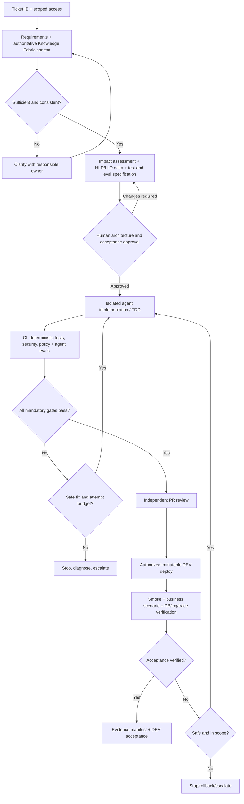

# CLM Agentic Engineering Blueprint

**Status:** Reference architecture and working design notes, **not an implemented automation system**.  
**Prepared:** 13 November 2026.  
**Audience:** Solution architects, engineering leads, developers, QA, DevSecOps, CLM product owners, platform/security teams.  
**Classification:** Generic blueprint only; do not commit client data, corporate credentials, production URLs, proprietary architecture, or sensitive internal documents into this personal repository.

> **Current stack:** GitHub Copilot subscription, VS Code/GitHub Copilot agent harness, and Claude (either as an available Copilot-routed model or a separately authorized Claude tool, depending on enterprise entitlement). **LiteLLM is NOT currently deployed in this workflow.** AWS Bedrock and LiteLLM are future integration options, not prerequisites.

## Purpose

Design a **governed, evidence-driven SDLC** for a Contract Lifecycle Management (CLM) platform. An eventual agentic workflow will take a work-item ID, retrieve requirements and authoritative project knowledge, generate a focused HLD/LLD delta and acceptance/evaluation plan, obtain approval, implement with GitHub Copilot agents, verify through deterministic tests and AI evaluations, open a PR, deploy through approved DEV CI/CD, inspect runtime evidence, and attempt only **bounded** fixes through fresh commits and repeat validation.

**Not the goal:** unrestricted autonomous production deployment, AI self-approval, rewriting an established project architecture each ticket, or replacing GitHub Copilot's harness with LiteLLM.

## Start here — reading order

1. [Strategy and current stack](docs/01-strategy-current-stack.md)
2. [Current Copilot and Claude capabilities](docs/02-copilot-claude-capabilities.md)
3. [Engineering architecture](docs/03-target-architecture.md)
4. [Architecture-document standards](docs/04-architecture-standards.md)
5. [SDLC stage and artifact contract](docs/05-sdlc-artifact-contract.md)
6. [Change classification, traceability, and approvals](docs/06-governance-and-traceability.md)
7. [Knowledge Fabric and GitNexus](docs/07-knowledge-fabric-gitnexus.md)
8. [Agents, skills, MCP, and tool permissions](docs/08-agent-catalog-and-tools.md)
9. [Ticket-to-verified-DEV workflow](docs/09-delivery-workflow.md)
10. [TDD plus Evaluation-Driven Development](docs/10-evaluation-driven-development.md)
11. [Evaluation datasets, graders and release gates](docs/11-evaluation-engineering.md)
12. [CI/CD, runtime verification and bounded repair](docs/12-delivery-operations.md)
13. [Security and enterprise controls](docs/13-security-risk-controls.md)
14. [Roadmap and implementation sequencing](docs/14-roadmap-and-measures.md)
15. [Decisions, open questions, alternatives](docs/15-decisions-and-open-questions.md)
16. [Reference links and standards](reference/sources.md)

## Documentation artifacts to use

| Baseline artifacts maintained per system | Change-specific artifacts per ticket | Execution evidence, linked not copied |
|---|---|---|
| Business glossary/rules, SAD (arc42-aligned), C4 diagrams, ADRs, API/data contracts, quality attributes/NFRs, test strategy, threat model, deployment topology, runbooks | Ticket brief, source-backed context packet, impact assessment, design delta, accepted test and AI evaluation specification, change risk and permission envelope | PR, code review, static and dynamic test reports, agent evaluation report, signed artifact, deployment ID, runtime traces/metrics/log queries, acceptance results and escalation record |

Use the **lowest artifact depth sufficient for the risk**. A trivial cosmetic fix should not require a full new SAD; a security boundary or high-value approval change may require formal review even if one line of code changes.

## Reference lifecycle

Every arrow represents a state transition validated by deterministic policy or an authorized human—not simply an LLM output.

## Current vs future technology responsibilities

| Responsibility | Prefer now | Optional future evolution |
|---|---|---|
| Interactive developer agent | GitHub Copilot harness in VS Code | Copilot SDK-based enterprise controller if warranted |
| Model reasoning | Copilot subscription models including available Claude models; separately authorized Claude harness where permitted | Model gateway / direct Bedrock for custom non-Copilot AI services |
| Code collaboration | GitHub branches, PRs, Actions | Dedicated cloud agent and agentic workflow where supported |
| Customization | `.github/copilot-instructions.md`, `.github/agents/*.agent.md`, `.github/skills/*/SKILL.md`, MCP | Versioned company-wide plugin distribution |
| Context | Project documents, code search and approved retrieval interfaces | Knowledge Fabric service, permission-filtered retrieval, indexed code graph |
| Verification | Unit/integration/contract tests and reviewed acceptance scenarios | Repeatable agent eval suites, independent graders and run evidence |
| Deployment | Existing controlled CI/CD to DEV | Durable cross-system workflow orchestration only when necessary |

## Templates and examples

- [Ticket brief](templates/ticket-brief.md)
- [HLD/SAD delta](templates/architecture-design.md)
- [LLD specification](templates/detailed-design.md)
- [ADR](templates/adr.md)
- [Impact analysis](templates/impact-analysis.md)
- [Acceptance and test specification](templates/test-specification.md)
- [AI Evaluation Specification](templates/ai-evaluation-specification.md)
- [Evidence and deployment report](templates/delivery-evidence.md)
- [Example CLM ticket](examples/CLM-142-example.md)
- [Illustrative release policy](examples/release-gates.yaml)
- [Agent and skill samples](.github/agents/requirements-analyst.agent.md)

