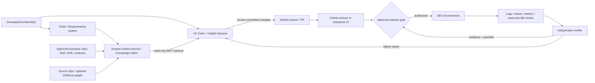

# 03 — Target architecture, boundaries and trust model

## System context

This is a **target** design. Ticketing, knowledge service, database, CI provider and observability tools may differ in the actual CLM environment.

## Core components

**Developer experience:** native GitHub Copilot harness with available models (Claude included where entitled), custom agents and skills. Human retains control of design and integration decisions.

**Knowledge Fabric:** access-filtered repository and document retrieval, authoritative source versions, optional static code graph, dependency discovery. MCP makes selected *tools* accessible to the harness. Retrieval is read-only by default.

**Delivery controller:** begin with GitHub issue/PR states and Actions checks. Introduce a durable workflow engine (e.g., Step Functions Standard) only when cross-system human approvals and long-running callbacks cannot be handled reliably by native tooling.

**Verification:** unit, integration, contract, security and runtime checks run as deterministic pipeline steps; agent evaluations measure behavior and reliability; approved rubrics govern subjective judgements.

**Deployment:** protected GitHub environments or equivalent; immutable artifact identified by commit SHA/digest; never allow an LLM to directly mutate a running service or production DB.

**Observability:** distinguish app telemetry from agent trace/audit telemetry. Link with ticket, PR, SHA, CI run, deploy ID, environment and trace IDs.

## C4-inspired system views

- **Context:** users, issue tracker, source repositories, knowledge stores, identity provider, dev platform and CLM runtime.
- **Containers:** IDE/Agent Host, scoped context service, Git platform, build pipeline, artifact registry, DEV runtime, evaluator, telemetry.
- **Components:** requirement extractor, context retriever, impact assessor, design generator, evaluator, CI integrator and remediation planner—only after their boundaries justify service separation.
- **Code:** selective; use generated class/call graphs only as implementation aids, not a universal architectural substitute.

## Trust boundaries

1. Tickets, docs, source files and logs are **untrusted input** to LLMs; their content is not an instruction override.
2. Agent-readable context is filtered by the developer's/project's permissions; prevent cross-project leakage.
3. Tool identities are separate: read-only knowledge, Git write, CI invoke, DEV deploy, monitoring, database diagnostic.
4. Approval and security gates are enforced by GitHub/platform controls rather than by a prompt.
5. Unknown requirements and contradictory evidence return to human review, not silent agent assumption.

## Cross-system traceability

`Ticket ID → requirement version → architecture baseline / ADR → design delta → test+eval specification version → PR → commit SHA → build/artifact digest → deployment ID → runtime evidence → acceptance status`

An evidence manifest must record the *same build artifact* in CI and DEV. Do not accept the agent's own 'done' message as deployment verification.

## Non-goals at first milestone

- Automated production deployment or arbitrary DB writes.
- Full replacement of developer judgement or independent test design.
- A new bespoke orchestration framework unless native GitHub capabilities prove inadequate.
- A single mandatory gateway for Copilot subscription traffic without an approved supported integration.
