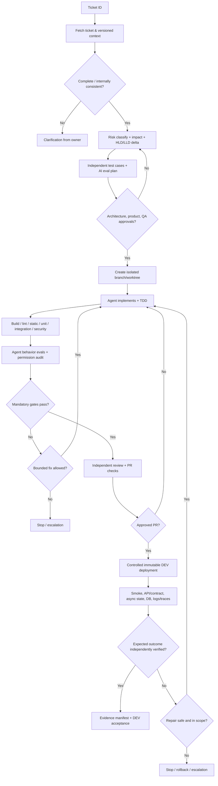

# 09 — Ticket-to-verified-DEV delivery workflow

## Objective

Input: an authorized ticket ID. Output: an accepted **DEV deployment** with independent, reproducible evidence or a bounded/diagnosed failure requiring human action.

**Do not mistake this document for a turnkey workflow:** ticket credentials, corporate repos, build pipelines, approval authorities, runtime APIs, DB schemas and production safety controls must be integrated and tested.

## Stateful workflow

## State contract

| State | Required preconditions | Durable outputs | Failure path |
|---|---|---|---|
| RECEIVED | Authenticated request | Ticket/revision/owner | Unreadable → BLOCKED |
| CONTEXT_READY | Authoritative sources retrieved | Context packet with source/version/uncertainty | Conflicts → NEEDS_CLARIFICATION |
| DESIGN_READY | Scoped risks/impacts | HLD/LLD delta, interface changes, decision options | Missing requirements → NEEDS_CLARIFICATION |
| APPROVED | Explicit human sign-offs | Signed design, acceptance tests and permission envelope | Changes → return to design |
| IMPLEMENTING | Isolated branch and permitted tools | Diff, commits, TDD logs | Tool policy violation → STOP |
| CI_VERIFYING | Version-pinned code and specs | CI run, checks, eval traces/scores | Repair eligible → bounded retry |
| PR_REVIEW | All mandatory checks passed | Review decision / issue list | Revisions → implementation |
| DEPLOYING_DEV | Approved commit/artifact and environment rule | Deployment ID, artifact digest, result | Failed deployment → rollback/escalation |
| VALIDATING_RUNTIME | Correct version running, known test environment | API/event/DB/log/trace evidence | Known issue → bounded fix, otherwise escalate |
| ACCEPTED_DEV | All acceptance criteria verified | Evidence manifest and status | n/a |

## Parallelism and idempotency

- Independent retrieval or non-mutating analyses may run in parallel.
- Multiple coding agents must use isolated worktrees/branches and coordinate contracts to prevent conflicting edits.
- Deploy jobs must be idempotent and keyed by artifact digest and environment; retries must not redeploy an unknown version.
- Every external action gets a correlation ID; replaying an event cannot create duplicate contracts or irreversible side effects.
- Use a queue/state store or durable orchestrator once callbacks span long periods; don't rely on an IDE chat staying open indefinitely.

## Example ticket impact (illustrative CLM-142)

Business rule: 'When a contract value exceeds the approved threshold, request an additional approval.' A reviewer must clarify **strict greater-than vs greater-than-or-equal, currency FX rules, amendment values and delegated authorities** before coding. The implementation path might touch a Java API, Flowable process, OPA policy, database entity, notification and integration tests; these are **hypotheses to confirm against the actual CLM repo**, not known deployed components.

## Repair cycle and escalation

- Maximum illustrative repair budget: **3 code-repair attempts per ticket per failure category**. Adjust by measured risk.
- Every repair commits to a new SHA, re-runs all impacted deterministic checks, and performs fresh DEV deployment/verification if behavior changed.
- Never grant agents permission to edit approved acceptance criteria, bypass branch protection, disable scans, mutate production data or change production credentials.
- On unknown failure, possible data corruption, high-risk migration, unauthorized access or oscillating code changes: stop, preserve evidence, page owner and roll back where safe.

## Completion artifact

`ticket + approved requirement/design/test/eval IDs + PR + reviewed SHA + CI run + artifact digest + DEV deploy ID + acceptance scenario results + relevant telemetry trace IDs + exceptions/escalations + approving human`.

See [delivery evidence template](../templates/delivery-evidence.md).
