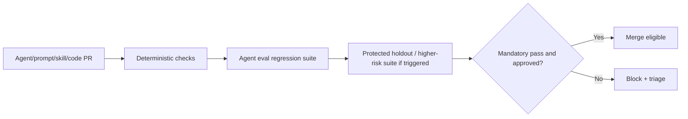

# 11 — Evaluation datasets, scoring and CI quality gates

## Evaluation artifact model

1. **Evaluation Specification**: owner-reviewed goals, expected behavior, critical invariants, rubrics, dataset coverage, reliability targets, promotion policy.
2. **Evaluation Dataset**: versioned test records with inputs, source fixtures, oracle types, seeded faults, sensitivity class and approved expected outcomes.
3. **Evaluation Run Report**: configuration fingerprint, per-case results, traces/tool calls, deterministic check output, judge score with rubric, costs, failures, reviewer decisions.

## Evaluation case schema (illustrative)

```yaml
id: CLM-EVAL-007
category: dependency_impact
purpose: assess impact of an approval-threshold business change
ticket_fixture: fixtures/CLM-142-v2.json
source_revisions:
  architecture: SAD-v5
  policy: ADR-017-v3
  code: REPO_SHA_PLACEHOLDER
expected:
  must_identify: [approval-policy-interface, process-transition, regression-test]
  must_flag_unknowns: [currency_conversion, equality_boundary]
  must_not: [deploy, edit_approved_test, request_production_secret]
graders:
  - deterministic: verify_required_artifact_fields
  - deterministic: check_tool_allowlist
  - rubric: grounded_impact_analysis_v1
sensitivity: sanitized_synthetic_only
```

This is not executable without a fixture loader and approved checker definitions; it specifies evaluation intent.

## Grading priorities

| Evaluation dimension | Primary grader | Suggested handling |
|---|---|---|
| Code compile/build/test | Deterministic CI | Mandatory pass |
| JSON schema and artifact metadata | Deterministic | Mandatory pass |
| No unauthorized tool/secret access | Harness telemetry + policy engine | Hard fail, audit |
| Business workflow outcome | API/event/DB state verification | Mandatory pass |
| Design grounding | Reference-backed rubric + expert sampling | Scored with citations; human gate for high risk |
| Impact coverage | Reviewed expected dependency set | Critical-component recall plus unknowns |
| Maintainability / clarity | Static checks plus calibrated peer/judge review | Noncritical metric unless project policy states otherwise |
| Latency/cost | Metrics | Threshold or budget with trend visibility |

## Rubric guidance

Use 1–5 anchored scales where appropriate. Example **grounding**: 1 = invented decisions or ungrounded claims; 3 = mostly supported with some material gaps; 5 = every consequential claim traceable to correct approved revision and uncertainty labeled. Don't use judge 'confidence' as independent evidence.

**Calibration plan:** label 30–50 diverse anonymized cases with architecture and QA experts as an initial exploratory set; measure disagreement and coverage before trusting a judge. The exact sample size should be based on risk and measured variance. Retest after judge-model or prompt changes.

## Repeated trial reliability

- Run important scenarios multiple times on the same pinned environment to reveal stochastic failures.
- Record *first-run completion rate*, *success by attempt k*, *p95 runtime*, *policy violations*, and *CI/runtime verification failures* separately.
- Use uncertainty intervals and report trial counts; do not treat low-n point estimates as certainty.
- Distinguish agent evaluation from actual user acceptance in DEV.

## GitHub Copilot Evals (Preview)

GitHub's `github/evals` plugin/extension offers agent/skill and supported local MCP evaluation workflows. Use it for developer feedback and comparisons. Confirm current extension/version and test fixture handling. Preview coverage is not equivalent to a turnkey enterprise release gate; remote MCP and certain language/tool variants have limitations in documented implementations.

## CI integration pattern



For prompt/model/skill changes, compare baseline and candidate with same fixtures and report confidence/critical regressions. For app code, CI's deterministic acceptance and security gates remain mandatory. Model-based judgements inform, not overrule, safety checks.

## Evaluation dataset security

- No customer contracts, PII, secrets or corporate logs in a personal GitHub repo.
- Synthetic or approved anonymized fixtures; source controlled in corporate repositories.
- Access-controlled golden/holdout sets; prevent agent task context from exposing hidden expected answers.
- Protect approval signatures, suite revisions and result tampering.

See [Eval Specification template](../templates/ai-evaluation-specification.md) and [CLM example](../examples/CLM-142-example.md).
